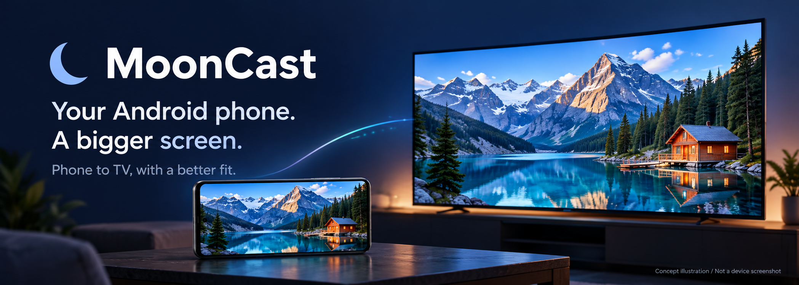
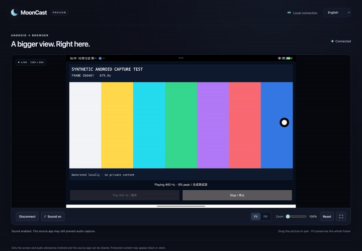
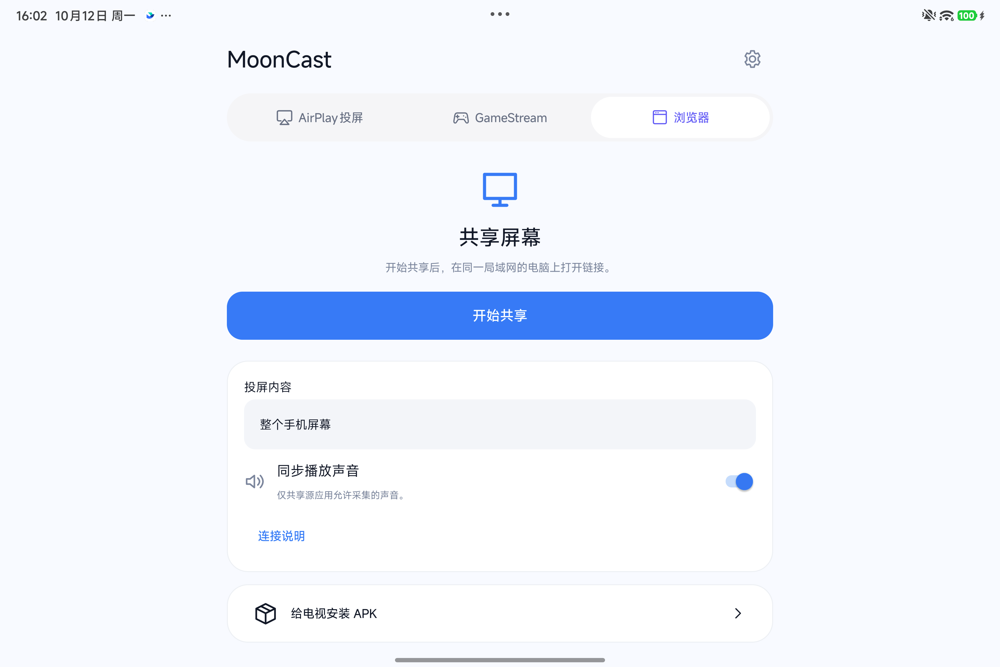
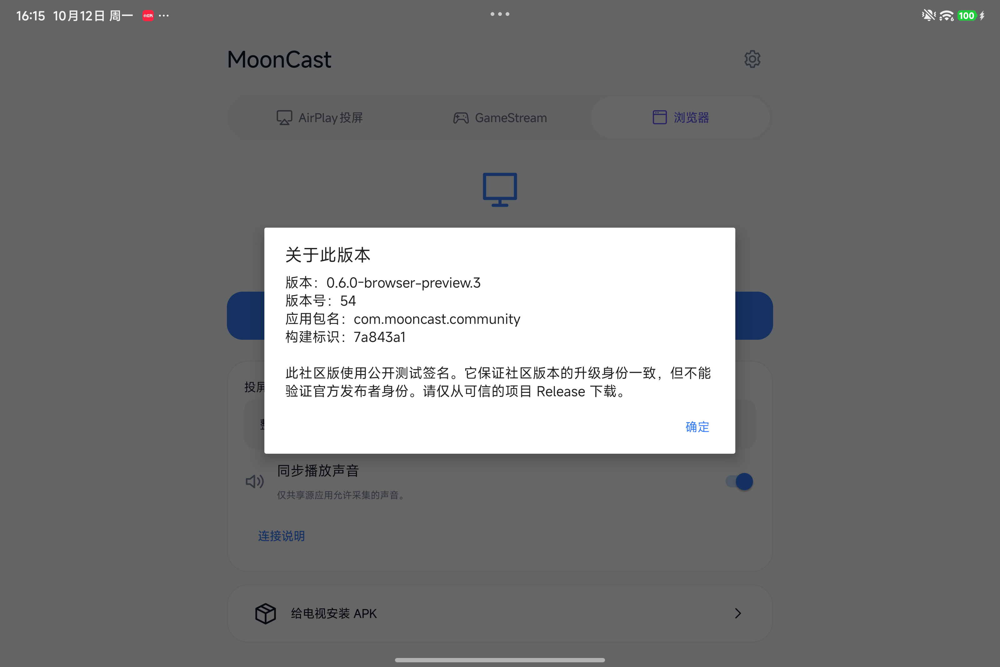
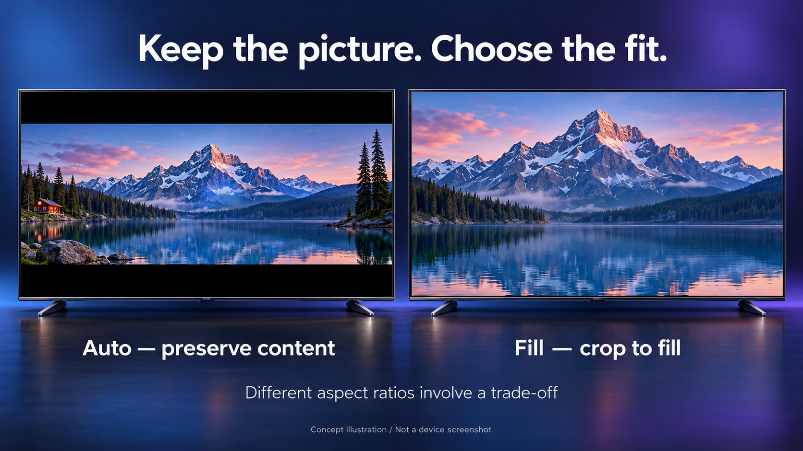
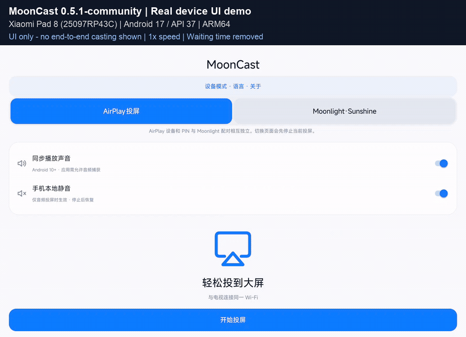

<p align="center"></p>

<p align="center"><sub>Model-generated brand illustration, not a device screenshot or an interoperability test.</sub></p>

<p align="center">
  <a href="https://github.com/meta-tabchen/MoonCast/releases/tag/v0.7"></a>
  
  
  <a href="LICENSE"></a>
</p>

<p align="center"><b>English</b> · <a href="README.zh-CN.md">简体中文</a></p>
<p align="center"><a href="https://github.com/meta-tabchen/MoonCast/releases/tag/v0.7">Download APK</a> · <a href="docs/browser-receiver.md">Browser quick start</a> · <a href="docs/unified-guide.md">TV setup</a> · <a href="docs/cropping.md">Cropping explained</a> · <a href="docs/unified-build.md">Build</a> · <a href="CONTRIBUTING.md">Contribute</a></p>

# MoonCast · Your screen, a better fit.

**Cast Android to a browser, an AirPlay receiver or a Moonlight client. Turn another Android device into a TV receiver, with framing controls that make better use of the screen.**

A video can already have black bars inside the phone's captured screen. Fitting that entire capture onto a TV adds another layer of empty space. MoonCast helps you reclaim that space: detect stable black borders, keep the useful picture in proportion, and adjust the framing when automatic detection is uncertain.

## 0.7: startup fixes and a better phone layout

- **Fix a reproduced GameStream identity-initialization class failure.** Align Bouncy Castle to the official BOM-compatible set: bcpkix/bcutil 1.85 and bcprov 1.85.2. The old mixed set threw NoClassDefFoundError during fresh identity creation; temporary-directory checks cover fresh/existing identity without rewriting existing keys.
- **Keep startup failures visible.** Persist a bounded startup stage/error and actively publish it before host teardown, so a short-lived process does not erase the reason before the UI polls.
- **Make phone protocol tabs readable.** Equal-width two-line labels address narrow layouts and English/Chinese wrapping.
- **Cancel while connecting.** Keep Disconnect reachable before the offer completes, covered by an added desktop-browser cancellation fixture.
- **Use an immersive browser view.** Controls auto-hide and return on touch, with safe-area layout. Missing or rejected fullscreen APIs fall back to page-level immersion; this does not promise to hide Safari or system bars.

**Validation scope:** Mac host/mock-layout/desktop-browser checks and both final ABIs’ signature/BC type-reference checks have results; there is no additional phone, iPhone or complete GameStream end-to-end acceptance. The local OriginalMediaServerTest connection-reset failure is retained; the first CI had a test-resolver failure; the repaired CI on b8be236 passed host/BC regressions, both ABI builds, lint and signature checks. The manual device job was skipped. [0.7 validation details](docs/release-0.7-validation.md)

## Scan the link, choose your quality

Automatic QR and quality controls retain the earlier code55 implementation. The short-window measurements below are historical pre-icon observations, not a new 0.7 device run.

- **The QR appears automatically.** After starting Browser sharing and accepting capture consent, the connection card shows a locally generated QR beside Copy link. Both encode the same temporary LAN URL; no QR service receives it. Stop clears the code. Keep a live code private, just like its link.
- **Choose detail or lighter traffic.** Smooth targets a maximum 720-pixel long edge / 24 fps / 2 Mbps; Balanced keeps the previous 1280 / 30 / 8 Mbps default. Clear selects the highest device-reported candidate up to 3840 / 30 fps / 24 Mbps, falling back to lower reported frame rates where needed.
- **Tune limits, then start a new session.** Advanced settings expose size, FPS and bitrate ceilings, filtered by reported hardware capability. Changes are saved for the next sharing lifetime; they do not restart or alter the active session. Output is not intentionally upscaled.
- **See what arrives.** Browser statistics separate target ceilings from received dimensions, codec, decoded FPS and RTP video Mbps. Fit/Fill/zoom changes presentation, not encoded detail.

### Measurements, not preset promises

Short-window observations during the code-55 development round were:

| Profile | Configured target ceilings | Observed browser reception |
|---|---|---|
| Clear | Long edge ≤3840, ≤30 fps, ≤24 Mbps | 3200×2136, about 25.2 decoded fps, 2.6 Mbps RTP video |
| Smooth | Long edge ≤720, ≤24 fps, ≤2 Mbps | 720×480, about 22 decoded fps, 0.48 Mbps RTP video |

These are brief observations, not sustained-performance guarantees, sender encoder bitrate or total LAN throughput. Clear passed five checks. Smooth's automatic Stop observation timed out; an independent subsequent check confirmed Stop and old-link closure. **Balanced, rotation and physical camera scanning were not tested in this round. The final icon-only build has no additional device validation.** Hardware capability reports do not establish stable 4K/30 operation; WebRTC still adapts to content, CPU and network. [Quality controls and evidence](docs/browser-qr-quality.md)

## Browser preview.3: real Android-to-Mac evidence



*MoonCast 0.6.0-browser-preview.3 / code 54 / build 7a843a1. Actual Xiaomi Pad 8 capture (Android 17 / API 37) travels through the production WebRTC path to Mac Chrome 154. The color bars and moving shape come from a dedicated Android test app, not a browser-generated sender. The GIF has no audio track.*

The receiver decoded **H.264 at 1280×854** and received **48 kHz Opus**. After enabling sound, decoded audio samples and nonzero energy increased. Live video continued while using Fit/Fill; normal Android Stop ended capture, closed the connection and made the old URL unavailable. **This establishes capture, transport and decoding for that tablet/browser pair. Speaker listening, A/V synchronization, rotation, TCL TVs and iPhone workflows were not validated.** [Measured scope](docs/browser-validation.md)

<p align="center"> </p>

*Actual code-54 tablet screens: the compact protocol selector, Browser sharing and installed version details. No session URL is shown.*

## Cast to a browser in three steps

1. Choose **Browser** in Android MoonCast, optionally enable playback audio, select **Start sharing**, and approve Android capture. Keep both devices on the same trusted LAN.
2. Open the **complete temporary link** shown by Android in Mac Chrome and select **Connect**. No receiver app, account or cloud signaling setup is needed.
3. Select **Enable sound** to allow playback. Use Fit/Fill, zoom, drag to pan or fullscreen. Stop sharing on Android to close the session and make its old link unavailable.

This preview has one viewer. Audio starts disabled and captures only playback the source app permits; microphone and remote input stay off. **Browser mode has no automatic black-bar detection**; TV Auto below belongs to the TV receiver path. The HTTP page/signaling is for a trusted LAN; media uses DTLS-SRTP. Restart sharing after an IP/network change. [Browser guide and safety](docs/browser-receiver.md)

Capability preflight can accept one reported-compatible encoder while WebRTC may select another encoder with the same MIME type that does not support the same advanced combination. This is a statically identified compatibility risk, not an observed universal failure; it does not invalidate the tested tablet results. Check actual statistics on other devices and restart with Balanced/Smooth if a connection fails.

## Why MoonCast

- **Open a browser and receive.** The new Android → WebRTC page path has been tested in Mac Chrome. No receiver installation; the temporary LAN link stops working when its session ends.
- **Less wasted screen space.** TV Auto framing looks for stable, paired black borders and fits the detected region to the display. It avoids stretching faces or making circles oval.
- **A steadier picture.** The TV detector waits for repeated evidence before locking a crop. After locking, its safety check can reveal more content when visible pixels appear outside the crop, rather than continually zooming in and out.
- **Fine-tune with your TV remote.** Keep the full image, remove detected borders, fill with a deliberate crop, or adjust four edges, zoom and position. A translucent settings panel lets you see the picture while adjusting it. Rescan when content changes.
- **One app on both devices.** Phones default to Send; Android TV/Leanback devices default to Receive. Switch and remember the role in settings. Switching stops the previous role; simultaneous sending and receiving is not supported.
- **Cast and transfer from one device picker.** My TV shows relevant casting and APK-receiving capabilities. Installing a transferred APK still requires approval on the TV.

Some MoonCast protocol paths remain experimental. Device reports and compatibility feedback are welcome.

## Black-bar removal and full-screen filling are different



*Model-generated illustration: the left view retains the wider picture and necessary bars; the right fills the display by cropping the house and edge trees. Not a device test or exact geometric simulation.*

| TV framing | What it does | Trade-off |
|---|---|---|
| **Auto · remove black bars** | Detects stable near-black borders, then fits the retained region proportionally | Detection can remain undecided; aspect-ratio differences can still leave bars |
| **Fit / full image** | Fits the complete source frame proportionally | Preserves source edges, including any embedded bars |
| **Fill** | Scales the full source until the display is covered | Content outside the display is cropped |
| **Manual** | Lets you set each edge, zoom and position | You decide which source content may be hidden |

Auto cannot reconstruct pixels, identify a subject, or distinguish every dark scene from a border. Subtitles, controls and unusually dark or asymmetric images can prevent detection. Select Fit to recover the complete frame; use Rescan after a content change. **Removing redundant black pixels does not guarantee edge-to-edge playback without losing picture content.**

## Cast to a TV in three steps

After installation and network setup:

1. Open MoonCast on the TV in **Receive** mode. Keep both devices on the same trusted LAN, with device-to-device access enabled.
2. On an Android phone, choose **AirPlay → My TV**, select the receiver, start sharing and approve Android's screen-capture prompt. On iPhone/iPad, select MoonCast through system AirPlay screen mirroring or the media route picker.
3. Play your video. TV Auto is the fresh-install default; allow several seconds of stable, visible content. Open framing controls to choose Fit, Fill, Manual or Rescan.

GameStream and DLNA use the connection flows listed below.

## How automatic cropping works

The TV samples a small preview, scans for paired near-black edges, checks that the interior contains distributed visible content, and waits for consistent borders before applying a proportional transform. Ordinary borders require 8 accepted samples; wide borders require 12. A post-lock safety check can widen the crop after two consecutive observations of visible content outside it.

This is a deterministic pixel-threshold and geometry algorithm, **not AI scene recognition**. The phone's sender-side crop pipeline uses separate rules and does not inherit every TV safeguard. [Read the implementation, thresholds and limitations →](docs/cropping.md)

## Choose your setup

**Movie night on a TV:** use MoonCast's receiver, start with Auto, and keep Fit one click away for subtitles or unusual framing. The receiver also accepts supported media URLs from compatible DLNA controllers.

**A phone on an iPad, TV or computer with Moonlight:** start the Android GameStream host and pair from the existing Moonlight client. No PC intermediary is needed. Pairing, client settings and hardware decoding remain part of the Moonlight workflow.

**Share the original file:** the sender's original-file cinema serves a selected photo, video or audio file through a tokenized LAN browser link without transcoding its bytes. Browser codec/container support still determines playback. This is separate from screen mirroring, DLNA receiving and Moonlight.

## Features, with their practical limits

| Area | Implemented capability | Scope / limit |
|---|---|---|
| Phone → browser | One WebRTC viewer; Fit/Fill, zoom/pan, optional playback audio | Tested in Mac Chrome; no Auto crop, remote input or cloud relay; TV browsers need testing |
| Phone → Moonlight | H.264 / HEVC SDR screen encoding; existing Moonlight clients | Lossy encoding; no HDR, AV1 or latency benchmark claimed |
| Phone → AirPlay | Android screen sharing to a compatible AirPlay receiver | AirPlay variants and hardware compatibility vary |
| TV receiving | AirPlay mirroring/media, supported DLNA URLs, GameStream client | Separate protocol paths; not Android's universal system Cast receiver |
| Phone framing | Whole screen, auto fit/fill, centered 16:9 region, stable Cinema | Sender auto detection is landscape-only; centered 16:9 assumes centered content |
| TV framing | Auto, Fit, Fill, four-edge Manual, zoom/pan and rescan | Rule-based detection; dark content and overlays can defeat it |
| Playback sound | Optional eligible playback-audio forwarding and local mute/recovery | Android 10+ capture requires source-app permission; Root capture is video-only |
| Profiles and presets | Receiver preferences; Movie/Game/Power saver presets | Do not replace Moonlight's resolution/FPS/bitrate settings or grant permissions |
| Runtime information | Capture submissions, app UID traffic and thermal information | Not end-to-end latency, receiver FPS, or measured power savings |
| Optional control | Accessibility gestures; Root/Shizuku continuous touch and basic keys | Off by default; explicit authorization; backend and ROM limitations |
| App capture | Android 14+ system app picker; Shizuku independent display | Picker capture has no reliable input mapping; independent display is video-only |
| Watch party | Experimental fan-out to up to three Moonlight receivers | Hardware encoding/network limits; common framing/audio packet duration; input off |
| Local panel power | Optional Root/Shizuku panel-off request with recovery lease | Experimental, ROM-dependent; physical panel behavior and savings need device tests |
| TV experience | Remote-friendly settings, four standby themes, translucent playback panel | Theme art is a standby background, not a playback overlay |
| APK transfer | User-enabled TV session, package review and Android installer | Ordinary `.apk` only; no silent install, `.apks` or `.xapk` handling |

Advanced sender features retain their [per-feature implementation and historical test notes](docs/feature-development.md). That historical evidence does not certify the current unified APK. Use [browser validation](docs/browser-validation.md) for the new path; earlier evidence remains historical.

## Download 0.7

[First phone/TV installation and troubleshooting](docs/unified-guide.md): the TV must already have MoonCast before it can receive APKs from the phone.

[Release notes](https://github.com/meta-tabchen/MoonCast/releases/tag/v0.7) · [ARM64 APK](https://github.com/meta-tabchen/MoonCast/releases/download/v0.7/MoonCast-0.7-arm64-v8a.apk) · [ARMv7 APK](https://github.com/meta-tabchen/MoonCast/releases/download/v0.7/MoonCast-0.7-armeabi-v7a.apk) · [Application source](https://github.com/meta-tabchen/MoonCast/releases/download/v0.7/MoonCast-0.7-source.zip) · [Notices](https://github.com/meta-tabchen/MoonCast/releases/download/v0.7/MoonCast-0.7-notices.zip) · [SHA256SUMS](https://github.com/meta-tabchen/MoonCast/releases/download/v0.7/SHA256SUMS)

Minimum Android 8.0. Choose one APK for the system ABI; each includes phone and TV roles. Version `0.7`, versionCode `57`; the fixed `com.mooncast.community` package and existing public test certificate are unchanged. Use the Release inventory for final provenance, artifact hashes and check results. The public test signer provides upgrade continuity, not publisher authentication.

Application source/notices supply pinned external WebRTC source/DEPS fetch/build mappings, **not a full offline SDK checkout; the prebuilt native SDK has not been independently rebuilt**. [Source scope](docs/browser-release-source.md) · [Version naming](docs/versioning.md).

[0.6.0-browser-preview.4 / code55](https://github.com/meta-tabchen/MoonCast/releases/tag/browser-v0.6.0-preview.4) · [0.6.0-browser-preview.3 / code54](https://github.com/meta-tabchen/MoonCast/releases/tag/browser-v0.6.0-preview.3) · [0.5.1](https://github.com/meta-tabchen/MoonCast/releases/tag/community-v0.5.1) · [0.5.0](https://github.com/meta-tabchen/MoonCast/releases/tag/unified-v0.5.0-preview)

Earlier public assets and media retain their original version labels. Numeric 0.6.0 remained a draft, not a previous public release; no draft download is linked here.

## How the devices cooperate

| Sending device | Receiving device | Workflow |
|---|---|---|
| Android MoonCast, Browser tab | Mac Chrome on the same LAN | Start sharing, open the temporary link and select Connect |
| Android MoonCast, AirPlay tab | MoonCast in TV mode or a compatible third-party AirPlay receiver | Open My TV, choose the receiver, start sharing and approve Android screen capture |
| Android MoonCast, Moonlight tab | MoonCast TV mode / official Moonlight client | Start the phone host, connect from the receiver, complete GameStream's PIN pairing |
| iPhone/iPad system AirPlay | MoonCast TV mode | Select MoonCast in Apple's screen-mirroring/media route picker |
| Compatible DLNA controller | MoonCast TV mode | Send a supported media URL to the receiver |

The single **My TV** picker combines casting and APK capabilities. An ordinary AirPlay TV is not assumed to accept APKs. APK transfer uses a user-enabled receiving session on MoonCast TV, fixed TCP port **48152**, with no separate transfer pairing code. GameStream's protocol pairing remains required.

## Send an APK

On TV enable **Install phone APK**. On the phone select an `.apk`, choose a capable TV in My TV and upload. The TV shows the parsed package and requires confirmation before opening Android's installer. If Android asks to allow installations from MoonCast, grant that yourself and return; the reviewed file remains available. There is no silent installation and no bypass for Android signing, version, compatibility or split-package requirements.

## Security and boundaries

- Browser HTML/signaling uses unencrypted HTTP; media uses DTLS-SRTP. Possession of the temporary link grants session access, and signaling does not authenticate against an active LAN attacker. No STUN/TURN, Internet traversal or multiple viewers; no browser-security override is required.

- For trusted LAN use. APK HTTP transport is **unencrypted**, bounded by size, concurrency, rate and session timeouts. Paths, content hashes, package parsing and private FileProvider access are checked. Do not expose the service to the Internet.
- Third-party receivers can have incompatible AirPlay variants. Miracast, Google Cast/Chromecast, Lelink, other OEM system-casting protocols and AirPlay 2 multiroom are not implemented. GameStream does not appear in Android's system Cast picker.
- DRM/protected content and apps that disallow playback capture may give black video or no forwarded audio. Mirroring is lossy; original-file serving is a different path.
- Advanced Root/Shizuku/Accessibility input remains optional and disabled until explicitly enabled. This preview does not change router or Android security settings.
- Builds and synthetic tests are not proof of physical TV/iPhone interoperability. See the validation report for passed and untested cases.

## Community updates and one-time migration

The older 0.5.0 uses `com.mooncast.unified.preview` and a disposable test signature. Its original signing identity is no longer available, so later builds cannot promise an in-place update of that package.

Since 0.5.1, community builds use the fixed package `com.mooncast.community` and a fixed public test-signing identity in the repository. Increasing versionCode will allow subsequent community builds to update in place. Moving from 0.5.0 requires a one-time migration, not a new package for every update. Private pairing state, settings and permissions do not automatically move across packages.

A public test key cannot establish maintainer authenticity: anyone can sign with it. Download from a trusted release source and check its published hashes. A future store edition will use a separate package and private production identity.

See the [community signing policy](signing/community/README.md) for the fixed identity and fail-closed build checks.

## Language

The in-app language picker introduced in 0.5.1 remains available. Historical tablet UI evidence is retained below; current browser measurements and limits are in browser validation.

Choose **Follow system**, **English** or **简体中文** in phone settings or TV advanced settings. Cancel and choosing the current language keep the session running; accepting another language stops the old session before reopening the selected role. Android 13+ also supports the system app-language selector. See the [language guide](docs/unified-guide.md) for the active-notification refresh limitation when changing language outside MoonCast.

## Historical UI demo · 0.5.1

> This records 0.5.1 only, not acceptance of the current browser build. The role-menu Cancel/same-role defect was fixed in the subsequent browser preview.



*Xiaomi Pad 8 · Android 17 / API 37 · MoonCast 0.5.1-community. Actual tablet UI, 16 seconds at original speed with waiting time removed. Shows Chinese-to-English language selection, phone-to-TV role switching and TV settings/focus. The TV interface is running on the tablet; no end-to-end cast or audio is shown.*

Seven tested cold launches took 268–509 ms with no observed ANR. System/English/Chinese preferences persisted after reopening in both roles; language Cancel/same-choice, Settings Back and directional focus passed. **Known issue in 0.5.1:** Cancel or reselecting the current **device role** recreates the phone screen or TV receiver. This differs from the passing language-menu checks. AirPlay audio, a TCL TV session, discovery and APK transfer were not tested in this one-device run.

## Build and contribute

Use JDK 17, Android SDK 35, Build Tools 35.0.0 and Gradle 8.9 / AGP 8.7.3. The current implementation is on `main`.

```sh
git clone --branch main https://github.com/meta-tabchen/MoonCast.git
cd MoonCast
python3 scripts/restore_release_inputs.py
python3 scripts/prepare_airplay.py --verify-sources
python3 scripts/prepare_airplay.py --verify-aar app/libs/airplaylib.aar
python3 scripts/prepare_unified_native.py
gradle :unified:assembleRelease :unified:lintRelease -PmooncastAbi=arm64-v8a
```

A full Git checkout builds the community release with the fixed public test identity initialized once by the owner. Verify it with `python3 scripts/verify_community_identity.py unified/build/outputs/apk/release/unified-release.apk`; add `--previous /path/to/previous-community.apk` to check update identity and increasing versionCode. Missing or changed signing inputs fail the build; no temporary identity is generated. Production builds are deliberately disabled until an independent private identity is implemented. Release source ZIPs exclude the MoonCast app-signing PKCS12 fixture; use `-PmooncastUnsignedVerification=true` for an unsigned `com.mooncast.community.verification` build, which cannot update the community app. Native rebuilding, inputs and packaging are in the [build guide](docs/unified-build.md).

A useful device report includes the sender and receiver models, Android/iOS and app versions, protocol, codec/resolution/FPS/bitrate, framing mode and reproduction steps. Separate “connects,” “video works,” “audio works” and “crop behaves correctly”; redact private logs and pairing information. [Report an issue](https://github.com/meta-tabchen/MoonCast/issues) · [Contribute](CONTRIBUTING.md) · [Security](SECURITY.md).

[Historical 0.3.1 sender README](docs/historical-sender-0.3.1.md) remains available as a separate archive, not a hidden part of the current introduction. It describes that historical version only.

## Source and credits

Phone GameStream hosting derives from Mirror/Sunshine; AirPlay sending uses the pinned Go sender; receiving uses patched AndroidAirPlay/UxPlay plus Media3/DLNA and Moonlight core. The two OpenSSL builds are packaged with distinct names and processes, not arbitrarily merged. Browser mode adds an open-source WebRTC SDK. Its fixed external source/dependency definitions, original notices and build mapping are documented in [source scope](docs/browser-release-source.md); the application archive is not a complete offline SDK checkout. [Third-party notices](THIRD_PARTY_NOTICES.md) and [theme licensing](docs/tv-themes.md) apply. MoonCast is an independent GPLv3 project, not an official Apple, Moonlight or Sunshine release.

Historical standalone behavior and test evidence remain in `docs/`; old results must not be read as acceptance of new unified builds. Publish APK variants, application source with SDK source directions/notices, and SHA256SUMS together.
