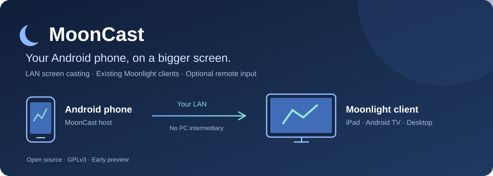

# MoonCast · one app, two roles

[简体中文](README.zh-CN.md) · [Setup and troubleshooting](docs/unified-guide.md) · [Build / native isolation](docs/unified-build.md) · [Validation matrix](docs/unified-architecture-validation.md) · [GPLv3](LICENSE)

**MoonCast 0.5 is an experimental unified Android sender and receiver.** Install the same app on your phone and TV. Android TV/Leanback devices default to **Receive**; phones default to **Send**. Device mode settings can override that choice and remember it. Switching roles stops the previous role. This is not simultaneous send-and-receive.

## Download 0.5.0 unified preview

[Release notes and all assets](https://github.com/meta-tabchen/MoonCast/releases/tag/unified-v0.5.0-preview) · [ARM64 APK](https://github.com/meta-tabchen/MoonCast/releases/download/unified-v0.5.0-preview/MoonCast-0.5.0-unified-arm64-v8a.apk) · [ARMv7 APK](https://github.com/meta-tabchen/MoonCast/releases/download/unified-v0.5.0-preview/MoonCast-0.5.0-unified-armeabi-v7a.apk) · [Complete corresponding source](https://github.com/meta-tabchen/MoonCast/releases/download/unified-v0.5.0-preview/MoonCast-0.5.0-unified-complete-source.zip) · [SHA256SUMS](https://github.com/meta-tabchen/MoonCast/releases/download/unified-v0.5.0-preview/SHA256SUMS)

Use ARM64 for a device with a 64-bit ARM Android system; use ARMv7 for a 32-bit ARM system. Check the device's supported ABI rather than its marketing CPU name. Both APKs contain the same phone and TV roles; install only one variant per device. These are signed experimental preview APKs. CI's unsigned verification APK is not an installable release download. No x86 APK is published in this release.

The source branch is `unified/android-0.5.0`. Before building a Git checkout, run `python3 scripts/restore_release_inputs.py`; see [build instructions](docs/unified-build.md). The complete source ZIP already includes these pinned dependencies and does not contain private signing keys.

## How the devices cooperate

| Sending device | Receiving device | Workflow |
|---|---|---|
| Android MoonCast, AirPlay tab | MoonCast in TV mode or a compatible third-party AirPlay receiver | Open My TV, choose the receiver, start sharing and approve Android screen capture |
| Android MoonCast, Moonlight tab | MoonCast TV mode / official Moonlight client | Start the phone host, connect from the receiver, complete GameStream's PIN pairing |
| iPhone/iPad system AirPlay | MoonCast TV mode | Select MoonCast in Apple's screen-mirroring/media route picker |
| Compatible DLNA controller | MoonCast TV mode | Send a supported media URL to the receiver |

The single **My TV** picker combines casting and APK capabilities. An ordinary AirPlay TV is not assumed to accept APKs. APK transfer uses a user-enabled receiving session on MoonCast TV, fixed TCP port **48152**, with no separate transfer pairing code. GameStream's protocol pairing remains required.

## Quick start

1. Install the correct standalone APK for each device's CPU. Each APK works independently; ABI variants are the same app, not separate phone/TV products. Minimum Android 8.0 (API 26).
2. Put both devices on a trusted LAN with device-to-device connectivity. Start MoonCast in Receive mode on the TV. Stop old MoonCast receivers first to avoid listening-port conflicts.
3. On the phone, select AirPlay or Moonlight and follow the matching workflow above. Capture/audio/remote input are separate permissions; only enable what you need.
4. TV settings offer Moon Lake, Aurora, Mist Mountains and Midnight standby themes. The last theme is remembered. During video playback settings use a translucent panel; standby backgrounds are not drawn over the video.

### Send an APK

On TV enable **Install phone APK**. On the phone select an `.apk`, choose a capable TV in My TV and upload. The TV shows the parsed package and requires confirmation before opening Android's installer. If Android asks to allow installations from MoonCast, grant that yourself and return; the reviewed file remains available. There is no silent installation and no bypass for Android signing, version, compatibility or split-package requirements.

## Security and boundaries

- For trusted LAN use. APK HTTP transport is **unencrypted**, bounded by size, concurrency, rate and session timeouts. Paths, content hashes, package parsing and private FileProvider access are checked. Do not expose the service to the Internet.
- Third-party receivers can have incompatible AirPlay variants. Miracast, Google Cast/Chromecast, OEM system-casting protocols and AirPlay 2 multiroom are not implemented. GameStream does not appear in Android's system Cast picker.
- DRM/protected content and apps that disallow playback capture may give black video or no forwarded audio. Mirroring is lossy; original-file serving is a different path.
- Advanced Root/Shizuku/Accessibility input remains optional and disabled until explicitly enabled. This preview does not change router or Android security settings.
- Builds and synthetic tests are not proof of physical TV/iPhone interoperability. See the validation report for passed and untested cases.

## Installation and migration

The unified preview uses a new package, `com.mooncast.unified.preview`, and launcher name **MoonCast**. Version and package are under About. It installs alongside earlier phone/TV previews; it does not import their private pairing keys, settings or permissions. An experimental test signature is not a production update promise. Keep previous apps until you have verified your devices, but run only one receiver at a time.

## Source and credits

Phone GameStream hosting derives from Mirror/Sunshine; AirPlay sending uses the pinned Go sender; receiving uses patched AndroidAirPlay/UxPlay plus Media3/DLNA and Moonlight core. The two OpenSSL builds are packaged with distinct names and processes, not arbitrarily merged. Matching source bundles contain pinned native sources, local patches, binary hashes and build recipes. [Third-party notices](THIRD_PARTY_NOTICES.md) and [theme licensing](docs/tv-themes.md) apply. MoonCast is an independent GPLv3 project, not an official Apple, Moonlight or Sunshine release.

Historical standalone behavior and test evidence remain in `docs/`; old results must not be read as acceptance of new unified builds. GitHub releases should publish APK variants, the matching complete source archive and SHA256SUMS together.
