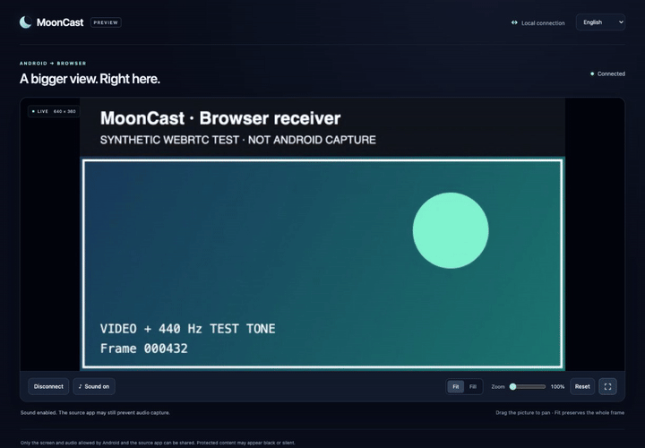

# Browser preview validation

This record describes local Mac validation on 2026-10-12. **Android-to-browser
end-to-end playback remains untested.** The device QA task owns ADB and installation;
this development task did not install, uninstall, stop ADB, or operate its tablet.

## Browser media and UI

The production receiver assets were served on an ordinary private-LAN HTTP origin
and exercised in Chrome 154.0.8037.99 on Mac. The page reported
`isSecureContext=false`, `RTCPeerConnection` available and `getUserMedia` unavailable.
No certificate bypass, camera permission, microphone permission, autoplay override,
disabled mDNS policy, or disabled browser sandbox was used.

The test sender produces a labelled canvas and a 440 Hz oscillator through an
actual WebRTC peer connection. A default two-Chrome mDNS attempt did not establish
ICE in this local setup. The passing fixture replaces only its own synthetic
sender's answer candidate address with its known private interface IPv4, preserving
the candidate port. This models a native sender's numeric host candidate; the
production receiver offer and browser policy remain unchanged. It does **not**
prove that the Android WebRTC implementation negotiates or captures correctly.

All 12 checks in `tests/browser_receiver_smoke.cjs` passed:

- Real ICE/DTLS-SRTP video and audio; manual connect and explicit sound gesture.
- Lost first answer recovery, another viewer's busy response, and same-tab reload.
- Audio capability downgrade, reconnect after sender loss, six-attempt retry limit,
  and explicit disconnect cleanup.
- Fit/Fill, zoom, drag pan, reset, fullscreen entry/exit, English/Chinese, and
  layouts at widths 375, 768 and 1440.
- A recording of the actual receiver page, with a visible synthetic-source label.

Decoded video advanced from 31 to 43 frames at 640×360. The selected ICE pair was
nominated and succeeded. After the sound gesture, the playing video element was
unmuted and inbound audio contained 70,080 samples with nonzero total energy
(`0.00028946087678760314`). Physical speaker audibility was not measured. The test
recorded no CSP violations or unhandled browser errors.

The 5.1-second GIF is an actual webpage capture with synthetic media, not a mockup
or Android capture. Its source WebM has no audio track. See
[`tests/browser-receiver-README.md`](../tests/browser-receiver-README.md) for the
reproducible command and fixture limitations. The evidence bundle includes the
machine-readable report, asset SHA-256 values, screenshots and recording.

## Native and build checks

The first ARM64 community Release build and Android lint passed. Lint reported zero
errors and 11 warnings; the TrustAllX509TrustManager warning is in the existing
Bouncy Castle dependency, not browser signaling. The final handoff records the
final APK hash and checks after all UI changes.

The pinned WebRTC AAR resolved and compiled against Android API 35. The release APK
verifier checks all 11 native payloads, ELF dependencies, packaged webpage bytes,
license notices and WebRTC classes. The community identity verifier checks the
unchanged package and certificate and versionCode 54 above the published 51. An
upgrade-compatible static result is not a device installation result.

The initial code-52 release lacked the JNI Zero `JniInit` class despite a literal
native SDK reference and no AAR consumer shrinker rules. Code 53 explicitly keeps
JNI Zero classes and the APK verifier now requires `JniInit`. This is a necessary
native initialization safeguard; device behavior is recorded separately by QA.

The portable Java suite covers signaling bounds, local HTTP policy, session state
and three-mode transitions. Separate dialog callback tests exercise cancel/back,
reselecting the active role, and confirmed role changes for both phone and TV.
The audio callback has been locally checked for a bounded 10 ms cadence and
silence filling; it still needs Android AudioPlaybackCapture validation.

## Required device acceptance

QA should first retest phone and TV role-menu cancel/back and same-role selection.
Then test the new tab navigation and About version against the installed APK.
On the same trusted LAN, start Browser sharing, open its temporary URL on Mac
Chrome, connect, enable sound and use content that explicitly permits capture.

Check screen and single-app capture, portrait/landscape rotation, hardware codec
selection, actual audible allowed playback, protected-content behavior, Stop from
both app and notification, process/peer loss, reload, network changes, and repeated
switches to the existing sender protocols. Also check denied audio permission and
Android versions below 10 with video-only behavior. Record real-device observations
separately. TV browsers, other desktop browsers, iPhone mirroring, throughput and
latency claims require additional evidence.
