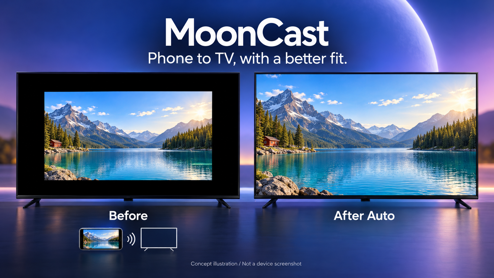

# MoonCast 怎样处理视频画面

[English](cropping.md) · [项目介绍](../README.zh-CN.md)

本文依据统一版源码 `f3566ab3194e660f987dcfabdc5f2ef22fe05255` 核对实现，解释行为，不代表性能测试或任意视频都能正确识别的保证。

*模型生成概念图，非实测截图或精确几何仿真。只有保留区域比例与目标屏幕匹配时，去冗余黑边才可能同时铺满。*

## 两类留白，处理方式不同

1. **嵌入源画面的黑边：** 比如居中视频被放在更宽的手机屏幕里，录屏已包含黑色像素。裁剪可以先去掉这些像素，再适配保留区域。
2. **宽高比不同产生的必要留白：** 完整的 16:9 视频放进 4:3 屏幕，仍需留边。想铺满就要舍弃部分画面或拉伸变形；MoonCast 的适应／自动模式保持比例。

检测器不会读取第三方应用内部的视频控件，也不从语义上识别人、字幕、电影或界面。它只判断像素与几何关系。手动裁剪与填满是主动取舍，不是恢复更多原始内容的证明。

## 电视接收端：先验证、再稳定、后保护

### 1. 小尺寸采样

`VideoFraming` 读取 **160 × 90** 的 TextureView 位图。电视播放轮询约每 **500 毫秒**为当前 GameStream、AirPlay 镜像或已就绪的媒体播放路径请求一次采样；手动编辑期间暂停。画面表面不可用或读取失败时拒绝样本；读取前清空位图，避免旧画面被当作新证据累计锁定。

### 2. 寻找可信的成对黑边

`CropGeometry.detectDetailed` 对小尺寸 RGBA 样本执行以下规则：

- RGB 每个通道都 **≤24** 才算近黑；最大通道 **≥52** 算检测用亮像素。
- 候选黑边行／列需要 **≥99%** 近黑像素，并且**没有亮像素**。采样中可见的字幕或指示条会阻止扫描继续；缩小采样仍可能漏掉细小内容。
- 每边扫描不到该维度的 **45%**。两侧差异不能超过 2 个采样像素或该维度 2% 中的较大值；不满足就放弃这一对边。保留两侧中较小的裁剪量。
- 全图至少要有 12% 非黑、10% 亮像素；再检查内部亮度、**4 × 4** 网格的内容分布与边缘过渡，以拒绝不明确暗场。
- 普通黑边内部需 ≥35% 活跃、≥22% 亮像素，且至少 8 个网格足够亮。宽黑边（单边≥29%）提高到 ≥50% 活跃、≥35% 亮、12 个网格，同时保留区至少占采样面积的 24%。
- 合格网格需要 ≥18% 亮像素；三像素宽的边界条也需 ≥18%。最后向外保留一个采样像素的安全余量。

代码的 `confidence` 是证据评分，**不是经过校准的正确概率**。

### 3. 稳定后锁定

`CinemaCropTracker` 接受 ≥0.87 的证据评分。普通黑边累计 **8** 个一致样本，宽黑边累计 **12** 个才锁定。候选边缘相差不超过 0.0126 个归一化单位；累计过程保留观察区域的并集，避免平均值吞掉边缘。完整画面、暗场或被拒绝的样本不会让裁剪锁定。

按标称采样间隔，通常需要约 **4 秒或 6 秒的合格样本**，但这不是完成时限：无效样本、播放状态和调度都会延长等待。锁定后不会随场景持续收紧。

### 4. 裁剪外出现内容时放宽

锁定后的安全路径检查被裁掉的轴外侧：至少四个采样像素存在 ≥72 的通道值，并连续两次得到一致证据，就将该轴恢复到完整范围。它只放宽，不重新收紧，直到重置／重新扫描。控制条或字幕出现时，黑边可能因此重新出现；这能减少一类误裁，不能保证字幕绝不被裁。

新视频、源尺寸变化或主动重新扫描会重置检测。全局画面偏好与每个视频的检测状态分开保存。手动编辑支持预览、应用与取消，不会把上一个视频的自动裁剪区域当作通用区域永久保存。

### 5. 等比缩放

`FramingTransform` 对两个轴使用相同的源像素缩放比例，并抵消 TextureView 默认拉伸。适应／自动取容器与区域比例中的较小值；填满取较大值，超出容器部分被裁掉。手动模式组合选区、缩放和平移。放大同样可能隐藏内容，裁剪并不天然无损。

## 安卓发送端：另一套流水线

发送端 `VideoPipeline` 采用 SurfaceTexture → OpenGL ES → 编码器 Surface。自动检测约每 **250 毫秒**读取一个 **192 × 128** 样本，不读取整张全分辨率画面。自动检测**仅横屏**启用，竖屏保留完整手机画面。

它的 `CropGeometry` 同样以 RGB≤24 判断近黑，但规则更宽松：≥12% 活跃像素、每边扫描不到 30%、成对边误差为 max(3 像素, 3.5%)、行≥92% 黑、列≥80% 黑（对细窄中性白色指示条另有容差），并保留一个采样像素余量。与电视检测不同，它可能忽略稀疏亮细节。

- **自动适应／填满：** 3 个一致样本后调整；放宽等待 6 个。暗场保留已有裁剪。
- **影院：** 8 个一致的非完整画面样本后锁定，直到重新扫描、捕获尺寸或模式变化；**没有电视端的锁定后安全放宽机制**。
- **居中 16:9：** 几何居中预设，不是自动识别播放器；竖屏保留全画面。

发送端在编码前裁剪，接收端在收到画面后调整显示。发送端已经丢弃的边缘，接收端无法恢复。排查异常时，先只调整一端的裁剪设置。

## 什么时候改用适应或手动

想检查完整边缘、字幕靠边、暗场、故意留黑的画面、特殊比例或结果不确定时，选适应。希望自己定义区域时用手动；接受损失部分画面以铺满屏幕时才用填满。DRM／受保护内容的黑屏不是可移除黑边，也不能靠裁剪修复。

## 源码与测试入口

- 电视：[VideoFraming](../tv/src/main/java/com/mooncast/tv/VideoFraming.java)、[CropGeometry](../tv/src/main/java/com/mooncast/tv/CropGeometry.java)、[CinemaCropTracker](../tv/src/main/java/com/mooncast/tv/CinemaCropTracker.java)、[FramingSession](../tv/src/main/java/com/mooncast/tv/FramingSession.java)、[FramingTransform](../tv/src/main/java/com/mooncast/tv/FramingTransform.java)
- 发送：[VideoPipeline](../app/src/main/java/com/mooncast/host/VideoPipeline.java)、[CropGeometry](../app/src/main/java/com/mooncast/host/CropGeometry.java)、[AutoCropTracker](../app/src/main/java/com/mooncast/host/AutoCropTracker.java)、[CinemaCropTracker](../app/src/main/java/com/mooncast/host/CinemaCropTracker.java)
- [电视影院约束测试](../scripts/test_tv_cinema_contract.py)、[电视可移植测试](../scripts/run_tv_unit_tests.py)、[发送端几何测试](../tests/CropGeometryTest.java)

生成画面测试验证的是实现约束，不证明所有真实电视、手机、播放器、字幕样式或流都表现正确。[统一版验证范围](community-validation.md)。
